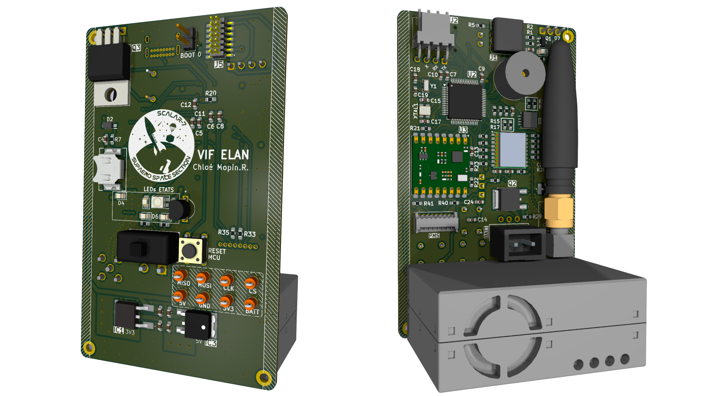
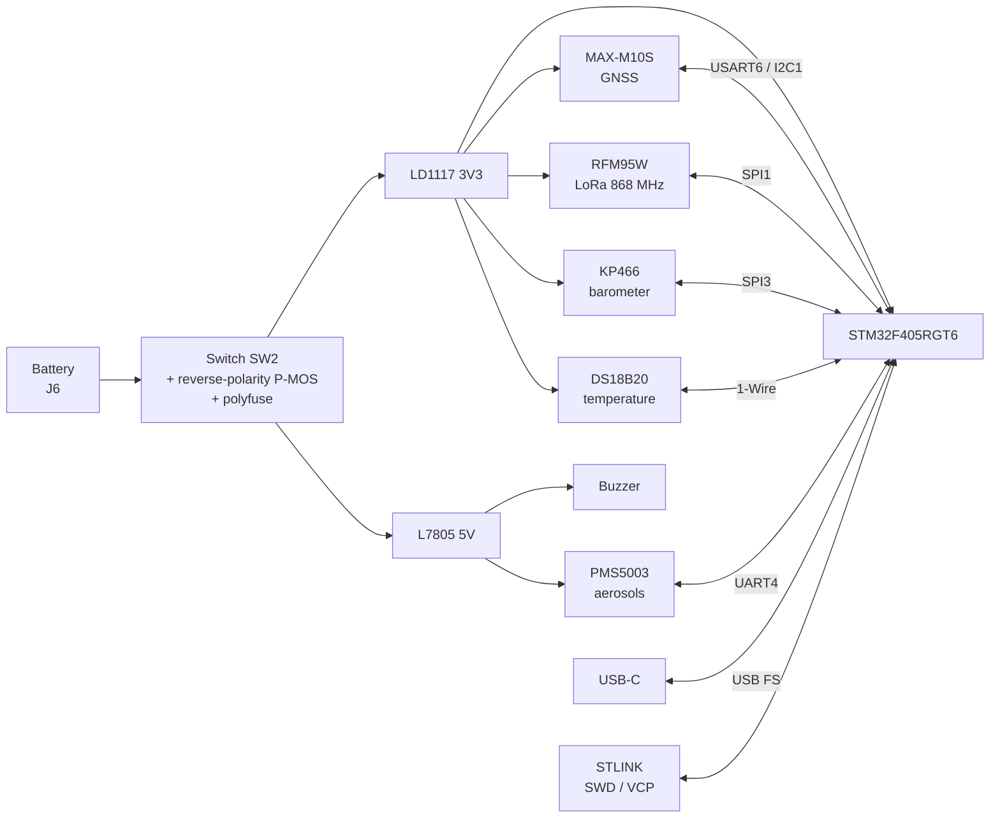

<p align="center">
  
</p>

# SCALAR-7_CanSat

<p align="center">
  
  
  
  
</p>

Electronics board of the CanSat carried by **SCALAR-7**, a two-stage rocket launched at **C'Space 2026**.
The board runs an **aerosol counting** experiment (PMS5003 sensor), complemented by pressure and temperature measurements, tracks the CanSat's position with GNSS and downlinks its data to the ground over LoRa.

---
## Table of contents

- [Board features](#board-features)
- [Architecture](#architecture)
  - [Power supply](#power-supply)
  - [Microcontroller](#microcontroller)
  - [Telemetry](#telemetry)
  - [Experiments](#experiments)
  - [Indicators](#indicators)
- [Main components](#main-components)
- [Repository structure](#repository-structure)

---

## Board features

| Function | Implementation |
|---|---|
| Processing / logging | STM32F405RGT6 (Cortex-M4F, 168 MHz), 12 MHz HSE + 32.768 kHz LSE crystals |
| Aerosol measurement | Connector for a **Plantower PMS5003** particle sensor (UART4) |
| Pressure measurement | **Infineon KP466** barometer (SPI3) |
| Temperature measurement | **DS18B20** probe (1-Wire) |
| Positioning | **u-blox MAX-M10S** GNSS module (USART6 or I²C1) |
| Ground link | **RFM95W** LoRa 868 MHz module (SPI1) |
| Power supply | Protected battery input (reverse polarity, overcurrent), 3.3 V and 5 V regulators |
| PC interface | USB-C (native STM32 USB FS, VBUS sensing), VCP serial port |
| Debug | 14-pin STLINK connector (SWD + SWO + VCP), reset button, BOOT0 jumper |
| Indicators | Buzzer, status LEDs (3V3, 5V, PPS) |

---

## Architecture




### Power supply

The board is powered by an external battery through a switch. The input is protected against reverse polarity (P-MOSFET) and overcurrent (polyfuse), then two linear regulators generate the **3V3** rail (logic, sensors, radio) and the **5V** rail (aerosol sensor, buzzer).

### Microcontroller

An **STM32F405** handles sensor acquisition, GNSS management and LoRa frame transmission. It is clocked by a 12 MHz crystal, with a 32.768 kHz crystal for the RTC. The board is programmed and debugged through an **STLINK** connector (SWD + VCP serial port) and also provides a **USB-C** port, a reset button and a BOOT0 jumper.

### Telemetry

- **GNSS**: a **u-blox MAX-M10S** module provides the position and a PPS signal. It connects to an external antenna through an SMA connector and keeps its data in memory thanks to a backup battery.
- **LoRa**: an **RFM95W** module (868 MHz, SPI) sends the data to the ground through a patch antenna on a U.FL connector.

### Experiments

- **Aerosols**: **PMS5003** particle sensor, connected over UART.
- **Pressure**: **KP466** barometer over SPI.
- **Temperature**: **DS18B20** probe over 1-Wire.

### Indicators

An RGB LED and a buzzer show the system status, and indicator LEDs show that the power input and the 3V3 / 5V rails are present.

---

## Main components

| Ref. | Component | Function |
|---|---|---|
| U2 | STM32F405RGT6 | Microcontroller |
| U1 | u-blox MAX-M10S-00B | GNSS receiver |
| U3 | HopeRF RFM95W-868S2 | LoRa 868 MHz transceiver |
| IC2 | Infineon KP466PXTMA1 | Pressure sensor |
| U4 | Maxim DS18B20+ | Temperature sensor |
| IC1 | ST LD1117DT33TR | 3.3 V regulator |
| IC3 | ST L7805CDT-TR | 5 V regulator |
| Q2 | Vishay SQD50P04-13L | Reverse-polarity protection |
| F1 | Littelfuse 1812L260/16MR | Polyfuse |
| Q3 | IRLZ34NPBF | Buzzer driver |
| Q1 | 2N7002 | VBUS sensing |
| XTAL1 | ECS-120-8-33-JGN-TR | 12 MHz crystal |
| Y1 | ECS-.327-6-34RR-TR | 32.768 kHz crystal |
| LED1 | Würth 150141M173100 | RGB LED |
| SW1 | TE 1825910-6 | Reset button |
| SW2 | 25139NAH | Power switch |

---

## Repository structure

```
SCALAR-7_CanSat/
├── hardware/          # KiCad files and libraries
├── images/
├── schematic.pdf
└── README.md
```

---
